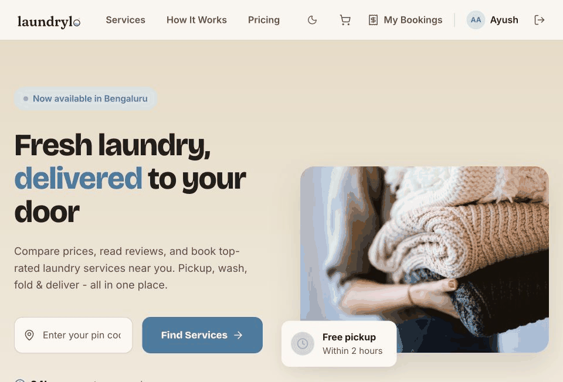
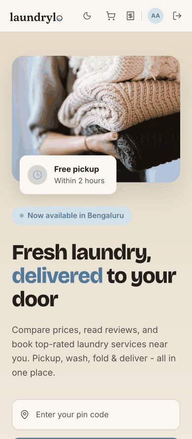
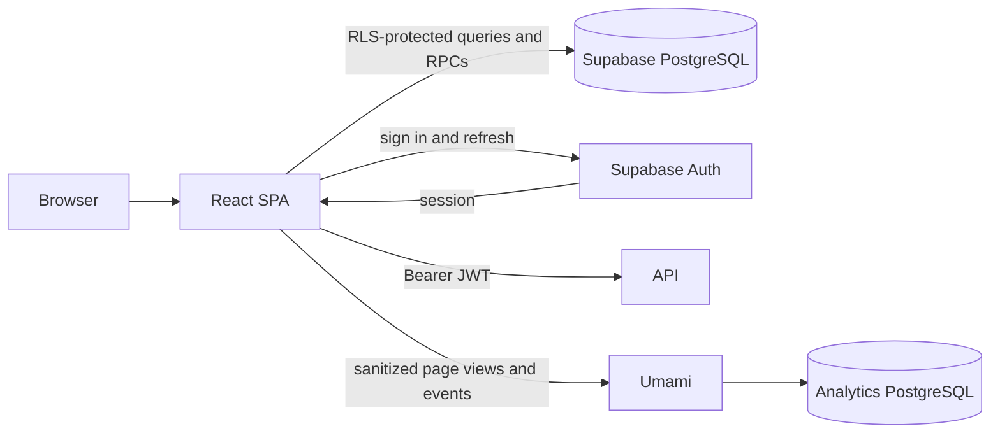

# SI MA ME

[](https://github.com/t1234ki/group15/actions/workflows/ci.yml)

SI MA ME is a Ghana-based laundry marketplace for discovering nearby businesses,
comparing per-item services, scheduling pickup and delivery, and tracking an
order. Nearby search, saved pickup addresses and laundry coverage use device GPS
coordinates after an explicit location request. The React client uses Supabase
Auth and PostgreSQL directly through the Supabase client, with Row Level
Security and database functions protecting data and transactional operations.

**Live → [laundrylo.com](https://laundrylo.com)**

## Product tour

The tour follows discovery, a partner catalogue, cart, pickup scheduling,
bookings and order tracking on both desktop and mobile.

### Desktop

[](https://laundrylo.com)

### Mobile

<p align="center">
  <a href="https://laundrylo.com">
    
  </a>
</p>

## What is implemented

- Responsive marketplace, partner listing, filters and sorting
- Nearby search using browser GPS coordinates; exact coordinates are not put in
  the page URL or sent to analytics
- Per-partner catalogues and a one-partner cart
- Pickup and delivery slot selection
- Persistent profiles and saved addresses, RLS-protected carts and order tracking
- GPS-based pickup serviceability with a 10 km default laundry radius, configurable
  from 1 to 25 km
- Customer cancellation and rescheduling before pickup with atomic slot-capacity updates
- Protected laundry-owner order queue with a daily operations summary, filters,
  fulfilment detail and confirmed status updates
- Owner-managed laundry profile, GPS service radius, booking state, weekly hours,
  holiday closures and date-specific capacity
- Owner-created catalogue services and items, with editable names, per-piece prices
  and customer availability
- Plus membership selection with server-computed pricing and discounts
- Supabase email/password authentication, email confirmation, password recovery,
  Google OAuth with PKCE, session restoration and current-session sign-out
- Installable PWA shell with offline caching for safe public reads, an in-app
  install prompt, and Add to Home Screen guidance for iOS
- PostgreSQL migrations, seed data, Row Level Security and transactional database functions
- Privacy-conscious Umami page views, product funnels and server-confirmed order events
- CI gates for frontend types, lint, tests and production builds

SI MA ME tables and RPCs live in the dedicated `laundry` Postgres schema, so
they can share a Supabase project with applications that already use `public`.
Marketplace listings and account resources are queried directly from Supabase.
Authenticated reads and writes are restricted by Row Level Security; operations
that must be atomic, including order placement, cancellation, rescheduling and
order-status changes, use narrowly scoped Postgres functions. Order placement
reprices the cart, reserves both slots, snapshots the address and catalogue,
activates a selected membership and clears the cart in one transaction.
Database resets intentionally do not add fictional laundry businesses. The
`api/` directory contains the former Hono service and is not required to run the
browser application.

## Architecture



There is no application API server in the browser request path. The Supabase
client sends authenticated queries directly to Supabase; RLS policies enforce
ownership, and Postgres functions preserve transactional invariants.
For a hosted project, add `laundry` to **Project Settings → API → Exposed
schemas** before using the browser client. SI MA ME creates its own profile
when a new Auth user signs up and provisions an existing shared Auth user only
when they use SI MA ME; the project's existing signup trigger remains intact.

See [docs/architecture.md](docs/architecture.md) for the detailed design.

## Stack

| Layer          | Technology                                                           |
| -------------- | -------------------------------------------------------------------- |
| Frontend       | React 18, TypeScript 5.6, React Router 7, Webpack 5                  |
| UI             | SCSS Modules, Lucide icons, GSAP + Lenis on `/journey`               |
| Client state   | React context, guest-cart `localStorage`, server cart after sign-in  |
| PWA            | Workbox service worker and web app manifest                          |
| Data           | PostgreSQL 17, Supabase migrations and seed data                     |
| Authentication | Supabase Auth JS, email/password, Google OAuth with PKCE             |
| Analytics      | Self-hosted Umami, sanitized product events and Cloudflare edge data |
| Quality        | ESLint, Stylelint, Prettier, Vitest, Testing Library, GitHub Actions |
| Hosting        | Vercel frontend, hosted Supabase                                     |

## Repository layout

```text
api/                  Former Hono API; not required by the browser app
docs/                 product, architecture, contract and schema documentation
supabase/migrations/  versioned PostgreSQL schema
supabase/seed.sql     Clears operational demo data; no sample businesses are seeded
ui/                   React SPA and frontend tests
```

## Local setup

### Prerequisites

- Node.js `22.13.0` or newer in the Node 22 line
- npm
- Docker Desktop or another Docker-compatible container runtime

### 1. Database

From the repository root:

```bash
npm ci
npm run db:start
npm run db:reset
```

This starts the local Supabase stack, applies every migration and loads the demo
configuration (no fictional laundries are seeded). `npm run db:status` prints
the local service URLs and keys. Supabase Studio
is available at [http://localhost:54323](http://localhost:54323), and local
confirmation and recovery emails appear in Mailpit at
[http://localhost:54324](http://localhost:54324).

If Docker is unavailable, use the plain-Postgres fallback in
[supabase/local/README.md](supabase/local/README.md).

### 2. Frontend

In another terminal:

```bash
cd ui
npm ci
cp .env.example .env
```

Set `SUPABASE_URL` and `SUPABASE_PUBLISHABLE_KEY` in `ui/.env` using the local
values from `npm run db:status`, then start the app:

```bash
npm run dev
```

Open [http://localhost:3000](http://localhost:3000). No API server is needed.
For a hosted Supabase project, set the same two browser-safe values from the
project's Connect panel. Never put a service-role key in the UI environment.

To apply the checked-in migrations to a hosted project, link the Supabase CLI
to that project and run `supabase db push` from the repository root. This
applies the versioned SQL files; there is no need to paste them individually
into the SQL editor. Before the first push, add `laundry` to the project's
exposed API schemas as described above; migrations do not alter the existing
`public` schema.

## Laundry owner and admin access

There is no shared admin password or public admin signup. Admins and laundry
owners use the same normal SI MA ME email/password sign-in:

1. A prospective owner creates a regular account at `/signup`, confirms their
   email if prompted, then opens **For laundry owners** in the header or
   **Laundry owner application** in the footer.
2. They submit the business application at `/owner`, tap **Use current
   location** while at the laundry and allow their browser to share its GPS
   coordinates, and upload a JPEG, PNG or WebP listing photo. Location is only
   requested after that button is tapped. They can sign in later to see the
   review status. An approved application creates an inactive laundry listing
   with its map location and photo; the owner then configures its hours and
   catalogue before accepting orders.
3. Admins sign in with their own regular account and review applications at
   `/admin`. The first admin must be promoted by a trusted project operator
   from the Supabase SQL Editor after that person has created their account.
   Replace the email below with the exact email for that existing account:

   ```sql
   do $$
   declare
       target_user_id uuid;
   begin
       select id into strict target_user_id
       from auth.users
       where lower(email) = lower('admin@example.com');

       insert into laundry.admin_users (user_id)
       values (target_user_id)
       on conflict (user_id) do nothing;
   end;
   $$;
   ```

   `INTO STRICT` makes the statement fail if the email is not exactly one
   existing Auth user. Do not expose the SQL Editor or database credentials to
   the admin user; after promotion, they sign into the app using their normal
   account credentials. Admin role changes are not available through the
   browser client.

Email/password auth works entirely against the local stack. To test Google
locally, copy the repository-root `.env.example` to `.env`, add a Google Web
OAuth client ID and secret, and set `auth.external.google.enabled = true` in
`supabase/config.toml`. Register `http://localhost:3000` as an authorised
JavaScript origin and `http://127.0.0.1:54321/auth/v1/callback` as an authorised
redirect URI, then restart the Supabase stack.

## Checks

Run each package independently:

```bash
# Frontend
npm --prefix ui run typecheck
npm --prefix ui run lint
npm --prefix ui run lint:styles
npm --prefix ui run format:check
npm --prefix ui test
npm --prefix ui run build

# Former API package; not required by the browser application
npm --prefix api run typecheck
npm --prefix api run lint
npm --prefix api run format:check
npm --prefix api test
npm --prefix api run build
```

`npm --prefix ui run check` runs the browser application's complete frontend
gate. The former API package remains in the repository but is not part of the
browser runtime.

## Deployment

### Frontend

Build from `ui/` with `npm ci && npm run build` and publish `ui/dist`. The build
requires `SUPABASE_URL` and `SUPABASE_PUBLISHABLE_KEY`; both are browser-safe
project settings. Set `UMAMI_HOST_URL`, `UMAMI_WEBSITE_ID` and `UMAMI_DOMAINS`
to activate anonymous product analytics. It includes the SPA `_redirects` rule
and a `_headers` rule that forces `service-worker.js` revalidation. Keep
generated source maps out of the public directory.

#### Deploying on Vercel

Import this repository into Vercel and set the project **Root Directory** to
`ui`. `ui/vercel.json` configures `npm ci` as the install command,
`npm run build` as the build command, and `dist` as the output directory. It
also sends app routes to the single-page app entry point, so refreshing a route
such as `/laundries` works.
Vercel only builds and hosts the frontend; it does not apply the Supabase
migrations. Prepare the target Supabase project separately before deploying.

Add these variables under **Project Settings → Environment Variables** for
Production (and Preview if you want preview deployments to use Supabase):

| Variable | Value |
| --- | --- |
| `SUPABASE_URL` | The project URL from the Supabase project's Connect panel |
| `SUPABASE_PUBLISHABLE_KEY` | The project's publishable key (or legacy anon key) |

`UMAMI_HOST_URL`, `UMAMI_WEBSITE_ID` and `UMAMI_DOMAINS` are optional; add all
three only if you use Umami analytics. `UMAMI_DOMAINS` should contain the
production hostname, for example `your-project.vercel.app`, or your custom
domain. Redeploy after changing variables because the frontend embeds them at
build time.

Only the Supabase URL and publishable/anon key belong in Vercel's frontend
variables. They are delivered to the browser. **Never add** a Supabase
service-role key, database password, Google OAuth client secret, or other
server credential to this frontend project.

### Supabase database

Create a hosted Supabase project, link the repository and apply the reviewed
migrations. Do not load `supabase/seed.sql` into production; it is demo data.
The latest migration adds simulated card/mobile-money payment reporting and
the 5% platform commission used by the admin and laundry-owner dashboards.
These payment choices do not charge or transfer real money; apply the migration
before enabling the updated booking flow.

```bash
npx supabase login
npx supabase link --project-ref <project-ref>
npx supabase db push --dry-run
npx supabase db push
```

The browser app connects through Supabase Auth and PostgREST using its project
URL and publishable key. It does not need a separate API deployment, database
password, service-role key or `/api` proxy.

### Authentication

1. Set the Supabase Auth Site URL to your production Vercel URL (or custom
   domain). Add that origin's `/auth/callback` and `/update-password` URLs to
   the redirect allow list. Keep localhost redirects on the local project, not
   the production project.
2. Enable email/password authentication, email confirmation and secure password
   changes. Configure production SMTP before relying on verification or
   password-reset email delivery.
3. For Google sign-in, create a Web OAuth client and add
   the production Vercel URL (or custom domain) as an authorised JavaScript
   origin. Add
   `https://<project-ref>.supabase.co/auth/v1/callback` as an authorised redirect
   URI, then store the client ID and secret in the Supabase Google provider
   settings and enable the provider.
4. Expose only the Supabase project URL and publishable key to the browser. Keep
   the database password, provider secret and any service-role key private.
5. Verify email sign-up, password reset, Google sign-in, token refresh and
   sign-out on the production origin. Verify that protected reads and database
   functions are restricted to the signed-in user and laundry owner.

### Analytics

Deploy an open-source Umami instance with its own PostgreSQL database, add
`laundrylo.com`, then configure the frontend variables described above. The
integration is disabled when those values are blank, so local development does
not pollute production data. Dynamic record ids and raw search inputs are
removed before tracking; only restricted `utm_*` campaign tags are retained.

See [docs/analytics.md](docs/analytics.md) for the event catalogue, dashboard
funnel, retention policy, activation checks and the correct way to compare
Umami's browser sessions with Cloudflare's bot-inclusive edge traffic.

## Documentation

Start with the [documentation index](docs/README.md). The PRD defines the
product, the architecture document describes the implemented system and gaps,
the schema documents PostgreSQL and RLS, and the analytics guide documents
anonymous product measurement. `docs/api-contract.md` describes the former API.

The experimental wash-cycle journey remains available at `/journey` by direct
URL. It is intentionally not linked from the product navigation; its design and
motion decisions are preserved in [docs/journey.md](docs/journey.md).

## License

This project is available under the [MIT License](LICENSE).
